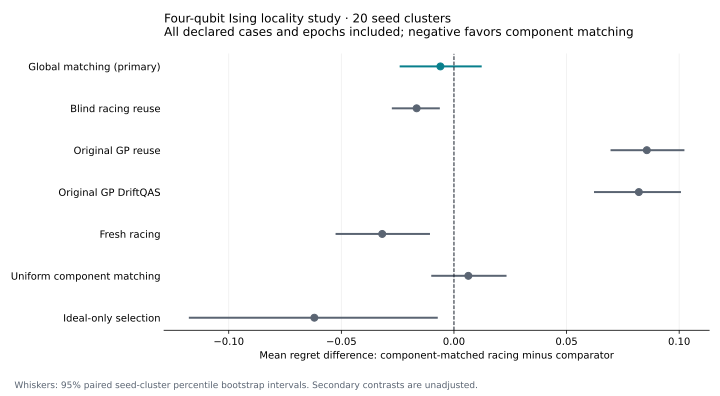

# Multi-edge locality study (v0.5)

This extends the v0.4 single-edge H₂ result to a stronger question: does component-matched
racing help **beyond global matching** when a circuit uses some physical edges but not
the one that changed? It remains fixed-library selection under synthetic CX noise.

The **predeclared primary comparison is inconclusive**. On 20 fresh test seed clusters,
component-matched racing's mean regret was **0.101401**, versus **0.107421** for global
matching. The paired difference was **−0.00601922**, with 95% seed-cluster bootstrap
interval **[−0.02410837, 0.01232203]**: 10 seeds favored matching, 2 tied and 8 favored
global matching. The interval includes a benefit and harm; neither superiority nor
noninferiority is established.

The **original GP baselines perform substantially better**. GP reuse's mean regret is
**0.0157630**, and the racing target has higher regret on all 20 seed clusters. The
secondary target-minus-GP-reuse contrast is +0.0856384, interval [0.0695260, 0.102333].
The corresponding contrast against original GP DriftQAS is +0.0820933, interval
[0.0621820, 0.100794]. These are descriptive, unadjusted secondary intervals.

This is a useful negative result: a genuine multi-edge reuse opportunity does not by
itself establish a better decision rule. The favorable secondary comparison against blind
reuse does not replace the global-matching primary contrast. No controller was retuned
after test inspection.

The completed test contains **60 paired episodes**, 480 policy episodes, 1,920 locked
recommendations and 15,360 full-bank predictions. See
[the complete test report](../examples/benchmarks/v05/held-out/report.md).



## Selection and actual spending

| Policy | Mean exact regret | Mean shots / epoch | Budget used |
|---|---:|---:|---:|
| Original GP reuse | 0.0157630 | 987.82 | 96.47% |
| Original GP DriftQAS | 0.0193082 | 990.85 | 96.76% |
| Ideal-only | 0.163390 | 204.00 | 19.92% |
| Fresh racing | 0.133259 | 972.00 | 94.92% |
| Blind racing reuse | 0.117973 | 972.00 | 94.92% |
| Global matching | 0.107421 | 972.00 | 94.92% |
| **Component-matched racing** | **0.101401** | **980.02** | **95.70%** |
| Uniform component matching | 0.0950084 | 980.02 | 95.70% |

Matching used **8.01667 more shots/epoch** than global matching (descriptive interval
[7.36667, 8.66667]); it did not demonstrate a shot-saving advantage. Batch/group alignment
can leave budget unspent. The uniform variant has a lower point-estimate mean regret than
the racing target, but their paired difference includes zero. The original GP policies
show why same-family and stronger-model controls both matter.

| Case | Matching minus global mean regret | Descriptive 95% interval | Better / tied / worse seeds |
|---|---:|---|---|
| Stable | 0 | [0, 0] | 0 / 20 / 0 |
| Abrupt end-edge | +0.000445358 | [−0.0434698, 0.0405631] | 7 / 5 / 8 |
| Abrupt central-edge | −0.0185030 | [−0.0496096, 0.0108035] | 6 / 10 / 4 |

The target and global policy tie exactly on stable cases. Neither changing case establishes
a separate mean-regret advantage. All cases and all 20 test clusters remain in the primary
average.

## Did the mechanism survive on fresh seeds?

Both changed-edge cases have tie-aware winner-set reversals and unaffected nonempty-
footprint winners in **19 of 20 test seeds**. Stable cases have neither. There are **zero
zero-exposure invariance violations**. The seeds without an opportunity remain included.
The same definitions were fixed in the development protocol; these are posthoc descriptions
of the complete test matrix, not a second selection gate.

Thus the development screen did identify an adaptation opportunity that mostly transfers
to new seeds. The controller's advantage over global matching remains unestablished despite
that opportunity.

## Raw uncertainty and independent confirmation

These are nominal Gaussian diagnostics, **not calibrated intervals**. Width is the mean
full interval length `2 × 1.959964 × model_SD` for the locked selected candidates, in
the Hamiltonian's energy units. Coverage averages correlated epochs/cases within seed;
point rates are not independent binomial trials.

| Policy | Raw selected model coverage | Mean selected model width | Fresh confirmation coverage |
|---|---:|---:|---:|
| Original GP reuse | 84.58% | 0.33257 | 94.58% |
| Original GP DriftQAS | 82.92% | 0.35834 | 94.17% |
| Ideal-only | 66.67% | 0.39199 | 95.42% |
| Fresh racing | 73.75% | 1.26755 | 97.50% |
| Blind racing reuse | 63.33% | 0.76788 | 95.83% |
| Global matching | 80.42% | 0.93264 | 96.25% |
| Component-matched racing | 79.58% | 0.85478 | 96.67% |
| Uniform component matching | 77.08% | 0.90958 | 95.00% |

All raw selected model coverages fall below nominal 95%. Good fresh-confirmation coverage
does not validate the adaptive model's uncertainty. H₂ interval temperatures were not
transferred; no new Ising calibration was fitted after looking at these results.

## Development decision, including failed cells

The [full grid and deterministic rule](multiedge_protocol.md) were committed as
`e05a86730496bfff27528b67d21ee0b32381783f` before screening. No controller was executed
or ranked during this selection. Every screened bank, trained parameter, compiled QASM,
audit row and failed cell is retained in
[the complete development screen](../examples/benchmarks/v05/screen/report.md).

| Field h/J | Fit-call cap / candidate | End-edge locality seeds | Central-edge locality seeds | Gate |
|---|---:|---:|---:|---|
| 0.5 | 120 | 0/5 | 0/5 | Failed |
| 1.5 | 120 | 5/5 | 5/5 | Selected by the fixed cheaper-first rule |
| 0.5 | 480 | 0/5 | 0/5 | Failed |
| 1.5 | 480 | 5/5 | 5/5 | Eligible, not selected |

Stable cases have no reversals. All cells have zero zero-exposure invariance violations.
The screen used 20 shared banks, **43,311 ideal objective calls**, **480 distinct exact
audits**, and **1,920 recorded audit rows**, with zero online shots. Increasing the fit
cap did not produce the required opportunity in the low-field cells.

A winner-set reversal means every tolerance-optimal former winner has positive current
regret greater than `1e-8`. A locality opportunity additionally requires a current winner
with a **nonempty compiled CX footprint** whose used-edge error rates did not change.
Product-only circuits do not pass this condition. This avoids the single-edge H₂
limitation, but a nonempty footprint does not certify state entanglement or a controller gain.

## Frozen evaluation

The selected field 1.5 / 120-call suite, full development data and
[freeze](../examples/benchmarks/v05/frozen_protocol.json) were committed as
`f4ac56229652bc65f02c98baed37ea5b5c17c37a` before test execution.

| Item | Declaration |
|---|---|
| Task | Four-qubit open-boundary Ising, J=1, h/J=1.5 |
| Bank | Eight stratified candidates; parameters fixed before online selection |
| Cases | Stable; abrupt end-edge 0–1; abrupt central-edge 1–2 |
| Noise | CX-only depolarization, base 0.005 and abrupt stress 0.12 |
| Epochs | Four per policy episode |
| Online cap | 1,024 shots/epoch, including 204 protected fresh confirmation shots |
| Batches | Low 32 / high 128 shots per measurement group |
| Primary | Component-matched racing minus global matching in mean exact selection regret |
| Controls | Original GP reuse/DriftQAS, ideal-only, fresh/blind/global racing, uniform component matching |
| Test | All seeds 6001–6020, all cases and epochs; no test-seed filtering |
| Inference | Case/epoch averages within seed, then 10,000 paired seed-cluster bootstrap resamples |
| Calibration | Seeds 5001–5020 reserved and not executed; no transferred v0.4 scales |

The frozen ID is `dbb4c9da5440991f8f32f0c1dbd9c9bfb53e8ea1bc2763a4441195570a74a8b5`;
the test protocol digest is
`261a7cd4426f3974f510832eb7912b15219ca5d39c2edd79054888187d4c3d35`.
Python 3.12.14, DriftQAS 0.5.0 and the scientific versions/thread counts recorded in that
freeze are required for exact suite resumption. Package source digest remains
`127cd7ef78d1cdad60df123d2d59d484a3c0a3b41f627fef316a5ead451b047d`.
Later changes to offline reporting scripts, tests and documentation do not change the
frozen controller. The underlying algorithms were not retuned on test outcomes.

## Boundaries and evidence

The field/training setting was selected using development audits and is a conditional,
mechanism-focused benchmark population. It does not establish generality across fields,
tasks, candidate banks or physical devices. Stress probability 0.12 is a synthetic setting,
not a typical device error rate. Hardware rates are exactly known; single-qubit/readout
errors, crosstalk, uncertain calibration and noisy online training are excluded.

Raw Gaussian prediction and fresh-confirmation coverage remain diagnostics. The new
study supplies **no calibrated Ising interval claim**. Future uncertainty calibration must
use an independent calibration artifact and a new fresh test partition; the already
inspected test seeds cannot be relabeled unseen. No arbitrary-drift guarantee, hardware
speedup, quantum advantage, unrestricted architecture search or novelty claim is made.

Compact exports omit raw counts/databases and cannot be passed to suite analysis.
The full development screen is directly verifiable from the repository. Full test logs,
counts, banks, ledgers, audits, QASM and original receipts are archived separately.

The separately downloadable `DriftQAS_v05_locality_raw_evidence.zip` contains **2,282
canonical/receipt files** plus an embedded per-file index. The
[catalogue and SHA256](../examples/benchmarks/v05/evidence_bundle.json) bind its exact bytes.
All 92 local tests, lint and formatting checks pass. The full test passed strict resume,
canonical SHA256 checks, SQLite/JSONL parity, complete prediction/audit grids and chronology,
posthoc locality diagnostics, and checksum-verified compact export. A reappearing runtime
lock was retained separately after the original process exited successfully, before resume;
no canonical data, source, declared setting or seed changed.

```bash
export OPENBLAS_NUM_THREADS=1 OMP_NUM_THREADS=1 MKL_NUM_THREADS=1
python -m driftqas verify-screen --screen-dir examples/benchmarks/v05/screen
python -m driftqas suite --config configs/locality_ising.yaml --split held_out \
  --frozen examples/benchmarks/v05/frozen_protocol.json --output results/new-locality-test
python -m driftqas diagnose-suite --suite-dir results/new-locality-test
python scripts/analyze_locality.py --suite-dir results/new-locality-test
```

Choose a new output directory for a replay. A different source or environment requires
its own new freeze rather than overwriting the recorded study.
